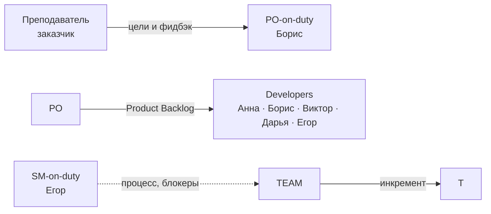
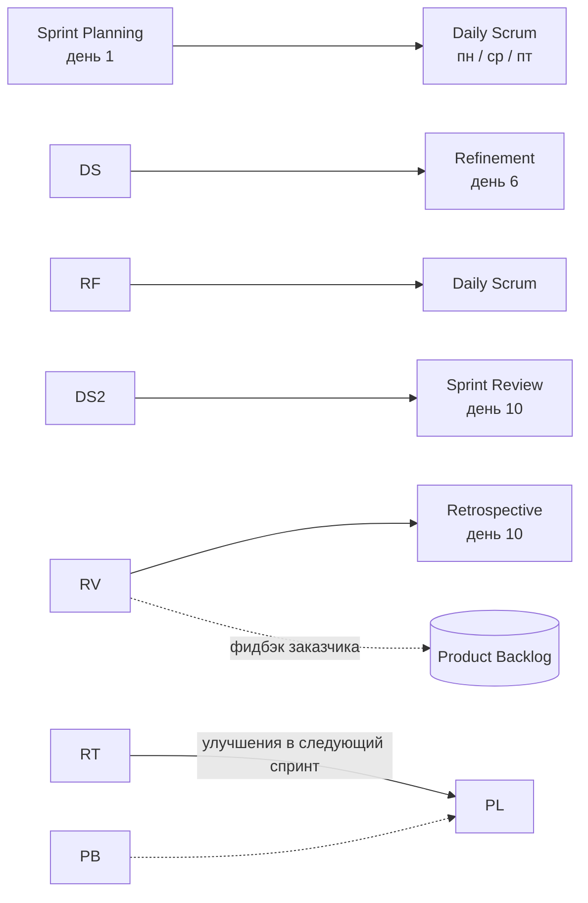
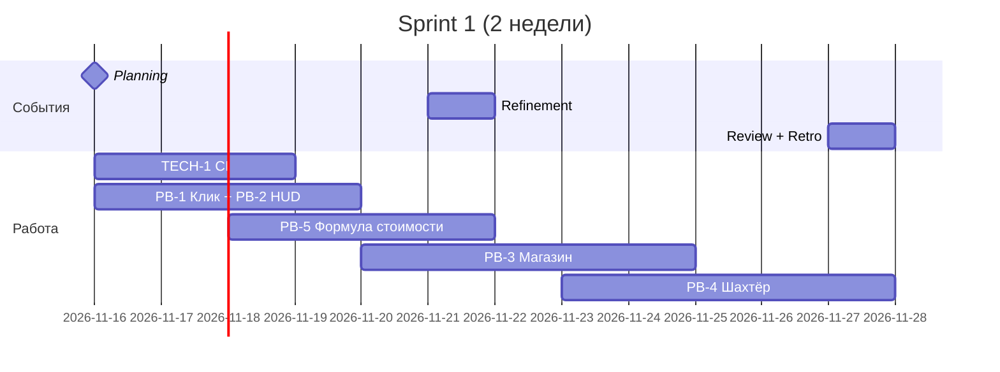
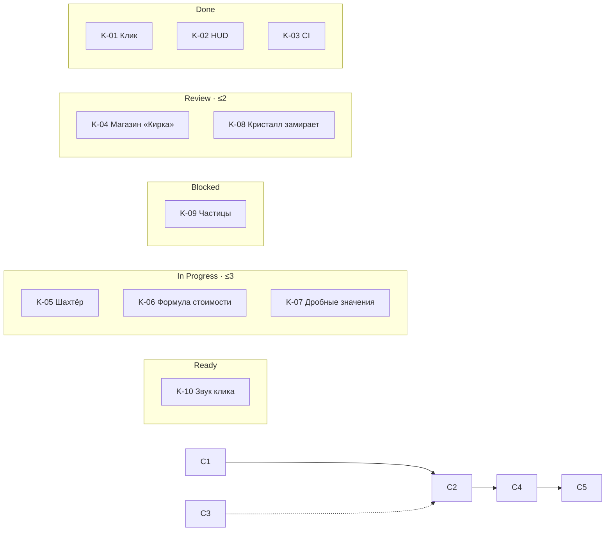
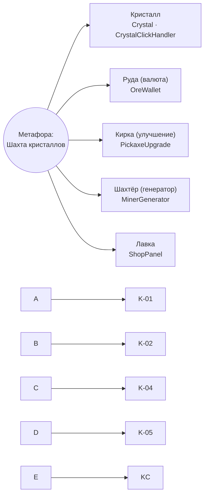
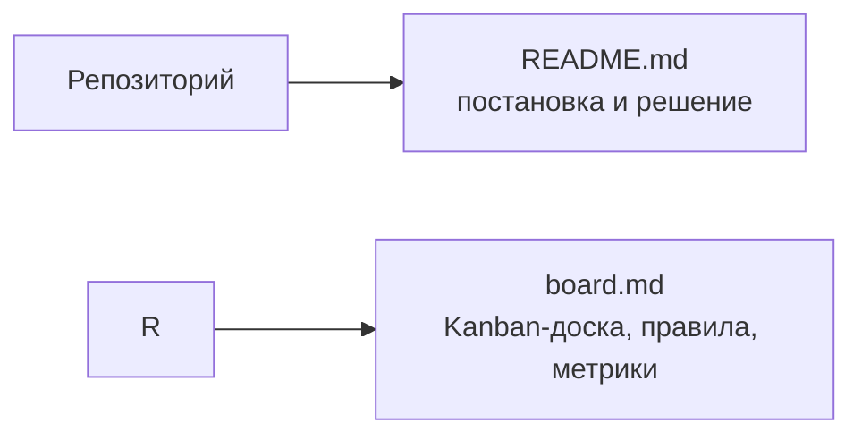

# Задача 11: Игра-кликер на Unity (учебный проект)

**Студент:** Карпач Владислав

## Постановка задачи

> Команда студентов без выделенного PO. Назначьте роли, опишите, кто выполняет обязанности PO/SM. Kanban на 10 игровых фич/багов. XP: Metaphor, Collective Ownership, Frequent Integration.

\---

## Решение

### 0\. Контекст проекта

**Продукт:** «Crystal Miner» — кликер на Unity 2022 LTS (2D). Игрок кликает по кристаллу, получает валюту, покупает улучшения кирки и нанимает автоматических шахтёров. Целевая платформа — WebGL (публикация на itch.io) + Windows-билд.

**Команда (5 студентов, \~8 ч/нед. каждый):**

|Участник|Основная специализация|
|-|-|
|Анна|Gameplay-программирование (клик, генераторы)|
|Борис|UI/UX (HUD, магазин)|
|Виктор|Экономика и баланс, сохранения|
|Дарья|2D-арт, анимации, звук|
|Егор|Сборки, CI, тестирование|

**Заказчик/стейкхолдер:** преподаватель курса (принимает результат на Sprint Review).

**Product Vision:** *«Простая и затягивающая игра на 5–10 минут, где каждый клик заметно что-то меняет, а прогресс ощущается за первые 30 секунд».*

\---

## 1\. Scrum

### 1.1 Роли без выделенного PO

Выделенного Product Owner нет, поэтому его обязанности **распределены и ротируются**, а решения принимаются по чётким правилам. Это сознательное отступление от «чистого» Scrum — оно обосновано размером команды и учебным контекстом.

|Роль|Кто (Спринт 1)|Ротация|Что делает|
|-|-|-|-|
|**PO-on-duty** (дежурный PO)|Борис|каждый спринт, по кругу|Владеет Product Backlog, расставляет приоритеты, пишет критерии приёмки, **единолично решает при споре**, общается с преподавателем-заказчиком|
|**Scrum Master-on-duty**|Егор|каждый спринт, по кругу (не совпадает с PO)|Ведёт события, следит за WIP и DoD, снимает блокеры, ведёт доску|
|**Developers**|вся команда (5 чел., включая PO и SM)|—|Оценивают, реализуют, тестируют|

**Правила, заменяющие «настоящего» PO:**

1. **Одна точка принятия решений:** при споре о приоритете решает PO-on-duty, обсуждение ограничено 5 минутами.
2. **Ценность проверяет заказчик:** на Sprint Review преподаватель принимает/отклоняет инкремент.
3. **Нельзя быть PO и SM одновременно**, а также два спринта подряд (против «захвата» процесса).
4. **Приоритизация по MoSCoW + «ценность/трудоёмкость»**, чтобы решение было объяснимо, а не «мне нравится».
5. Если PO-on-duty отсутствует более 2 дней — полномочия временно переходят к следующему по очереди.



### 1.2 Product Backlog (12 items)

Оценка в story points (SP); 1 SP ≈ 3–4 часа работы одного человека.

|ID|Элемент|Приоритет|SP|
|-|-|-|-|
|PB-1|Клик по кристаллу даёт +1 валюты|Must|3|
|PB-2|HUD: счётчик валюты|Must|2|
|PB-3|Магазин: улучшение «Кирка» (+1 к клику)|Must|5|
|PB-4|Автогенератор «Шахтёр» (пассивный доход)|Must|5|
|PB-5|Формула роста стоимости улучшений и баланс|Must|3|
|PB-6|Сохранение/загрузка прогресса (JSON)|Should|5|
|PB-7|Частицы и звук при клике|Should|3|
|PB-8|Оффлайн-доход при возвращении в игру|Should|5|
|PB-9|WebGL-билд и публикация на itch.io|Should|3|
|PB-10|Престиж «Новая шахта»|Could|8|
|PB-11|Достижения|Could|5|
|PB-12|Экран настроек (громкость)|Could|2|

Итого 49 SP. Прогнозируемая скорость команды в первом спринте — \~20 SP (5 чел. × 2 нед. × 8 ч ≈ 80 ч, минус ритуалы и запас).

### 1.3 Sprint 1: цель и Sprint Backlog

**Sprint Goal:** *«К концу спринта игрок может кликать по кристаллу, копить валюту и купить первое улучшение и первого шахтёра — играбельный вертикальный срез, собираемый CI».*

**Sprint Backlog (21 SP):**

|Элемент|SP|Ответственный|
|-|-|-|
|PB-1 Клик по кристаллу|3|Анна|
|PB-2 HUD со счётчиком|2|Борис|
|PB-3 Магазин «Кирка»|5|Борис + Анна|
|PB-4 Автогенератор «Шахтёр»|5|Анна|
|PB-5 Формула стоимости|3|Виктор|
|TECH-1 Настройка CI (GameCI)|3|Егор|

Звук/частицы (PB-7) берутся в спринт «по возможности» — см. доску.

### 1.4 События спринта (2 недели)

|Событие|Когда|Длительность|Как проходит у нас|
|-|-|-|-|
|**Sprint Planning**|пн, день 1|1,5 ч|PO представляет цель и топ бэклога; команда оценивает (Planning Poker), берёт работу по скорости, фиксирует Sprint Goal|
|**Daily Scrum**|пн/ср/пт 10 минут в Discord (команда не каждый день на парах)|10–15 мин|Что сделал → что буду делать → что блокирует; SM обновляет доску|
|**Backlog Refinement**|середина спринта (день 6)|40 мин|PO + команда дробят PB-6…PB-8, уточняют критерии приёмки|
|**Sprint Review**|пт, день 10|45 мин|Демо билда преподавателю, принятие по DoD, фидбэк идёт в Product Backlog|
|**Retrospective**|пт, день 10, после Review|30 мин|Формат Start/Stop/Continue; 1–2 конкретных улучшения на следующий спринт, ответственный и срок|



### 1.5 Definition of Done / Definition of Ready

**DoR (карточка готова к взятию):** есть описание, критерии приёмки (2–3 пункта), оценка в SP, нет неразрешённых зависимостей.

**DoD (карточка выполнена):**

* код влит в `main` через Pull Request с одним ревью;
* CI-сборка зелёная, Play Mode-тесты проходят;
* фича проверена в WebGL-билде (не только в редакторе);
* нет ошибок в консоли Unity при базовом сценарии;
* критерии приёмки подтверждены PO-on-duty.

### 1.6 Пример потока спринта



\---

## 2\. Kanban

Полная схема доски, легенда и правила — в [`board.md`](board.md). Здесь — краткое резюме.

**Колонки:** Backlog → Ready → In Progress (WIP 3) → Review/Playtest (WIP 2) → Done; дополнительная колонка **Blocked** вне WIP.

**Срез на день 6 спринта (10 карточек):**



**Узкие места:**

1. **Review/Playtest заполнена (2/2)**: билд проверяет в основном Егор. Из-за WIP-лимита K-07 не может перейти дальше, а K-10 из Ready **не берётся** — правило «сначала закончить, потом начинать».
2. **K-09 заблокирована** — ждёт спрайт-лист от Дарьи; Дарья перегружена анимацией. SM выносит блокер на ближайший Daily.

**Действия:** Анна и Борис вместо новых задач помогают с ревью K-04/K-08; Егор пишет короткий чек-лист playtest, чтобы ревью мог делать любой участник.

\---

## 3\. Extreme Programming (3 практики)

### 3.1 Metaphor — общая метафора системы

**Что делаем.** Вся команда использует единую метафору: **«Шахта кристаллов»**. Игрок — владелец шахты, клик — удар кирки, генераторы — наёмные шахтёры, улучшения — инструменты, престиж — «открыть новую шахту».

|Метафора|В коде Unity|На доске|
|-|-|-|
|Кристалл|`Crystal`, `CrystalClickHandler`|K-01 Клик по кристаллу|
|Кошелёк / «руда»|`OreWallet` (валюта)|K-02 HUD руды|
|Кирка (улучшение клика)|`PickaxeUpgrade`|K-04 Магазин «Кирка»|
|Шахтёр (генератор)|`MinerGenerator`|K-05 Шахтёр|
|Рынок/лавка|`ShopPanel`|K-04|



**Зачем.** Без PO нет одного человека, который объясняет «как должно быть». Метафора заменяет это общим языком: любой участник понимает, что делает `MinerGenerator`, не читая документ.

**Эффект и риск без практики.** Без метафоры в коде появились бы `Money`, `Coins`, `Score`, `Currency` для одного и того же — у нас этот риск уже был замечен на Planning (UI и экономика называли валюту по-разному), поэтому имя `OreWallet` зафиксировано в глоссарии.

### 3.2 Collective Code Ownership — коллективное владение кодом

**Что делаем.** Нет «своих» файлов: любой участник может править любой скрипт, префаб или сцену через Pull Request. Специфика Unity — **сцены и префабы конфликтуют при слиянии**, поэтому у нас:

* UI и объекты собираются в **префабы** (`ShopPanel.prefab`), а не лежат в одной общей сцене;
* в `.gitattributes` настроен UnityYAMLMerge, `Library/` игнорируется, крупные ассеты — в Git LFS;
* в сцену `Main.unity` вносят изменения короткими PR (≤ 1 дня), о правке сцены предупреждают в чате.

**Пример из доски.** K-07 (баг дробных значений валюты) нашёл Борис в UI, а исправил Анна в `OreWallet` (хотя это код Виктора по экономике) — правку не пришлось «согласовывать с владельцем»; Виктор получил PR на ревью.

**Эффект и риск без практики.** Без практики баг лежал бы, пока свободен Виктор — «bus factor = 1» на ключевом модуле. В учебном проекте участники регулярно пропускают недели из-за сессии, и узкое место превратилось бы в остановку спринта.

### 3.3 Frequent (Continuous) Integration — частая интеграция

**Что делаем.**

* Trunk-based подход: короткие ветки `feature/K-05-miner`, живут **не дольше одного дня**, в `main` попадает минимум раз в день.
* **GitHub Actions + GameCI**: на каждый PR запускаются Play Mode-тесты и WebGL-сборка (TECH-1/K-03).
* Красный CI = высший приоритет: сломавший билд чинит его до любой новой работы.

**Пример из доски.** Ветка K-04 (магазин) и K-05 (шахтёр) обе трогали `OreWallet`. Благодаря ежедневной интеграции конфликт возник в 5 строках на второй день, а не в 200 строках на девятый.

**Эффект и риск без практики.** Без частой интеграции у кликера с одной главной сценой «большой взрыв» перед Review практически неизбежен: билд не собирается в WebGL, а на демо показывать нечего.

### 3.4 Как практики связаны

```mermaid
flowchart TB
    MET\["Metaphor<br/>общий язык"] --> GOAL(\["Команда согласованно<br/>понимает, что делает<br/>(замена PO-контроля)"])
    COL\["Collective Ownership<br/>общая ответственность"] --> GOAL
    CI\["Frequent Integration<br/>быстрый сигнал"] --> GOAL
    CI -.->|красный билд = расхождение| MET
    CI -.->|любой чинит билд| COL
```

Метафора даёт **общий язык**, коллективное владение — **общую ответственность**, частая интеграция — **быстрый сигнал**, что язык и код всё ещё согласованы. Вместе они компенсируют отсутствие выделенного PO: команда реже расходится во мнениях о том, «что мы делаем», и быстрее замечает расхождения.

\---

## Структура репозитория



