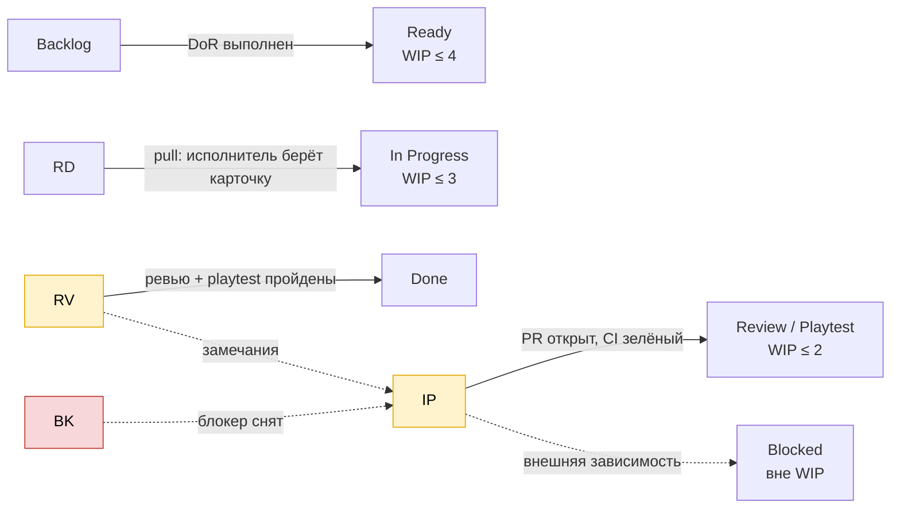
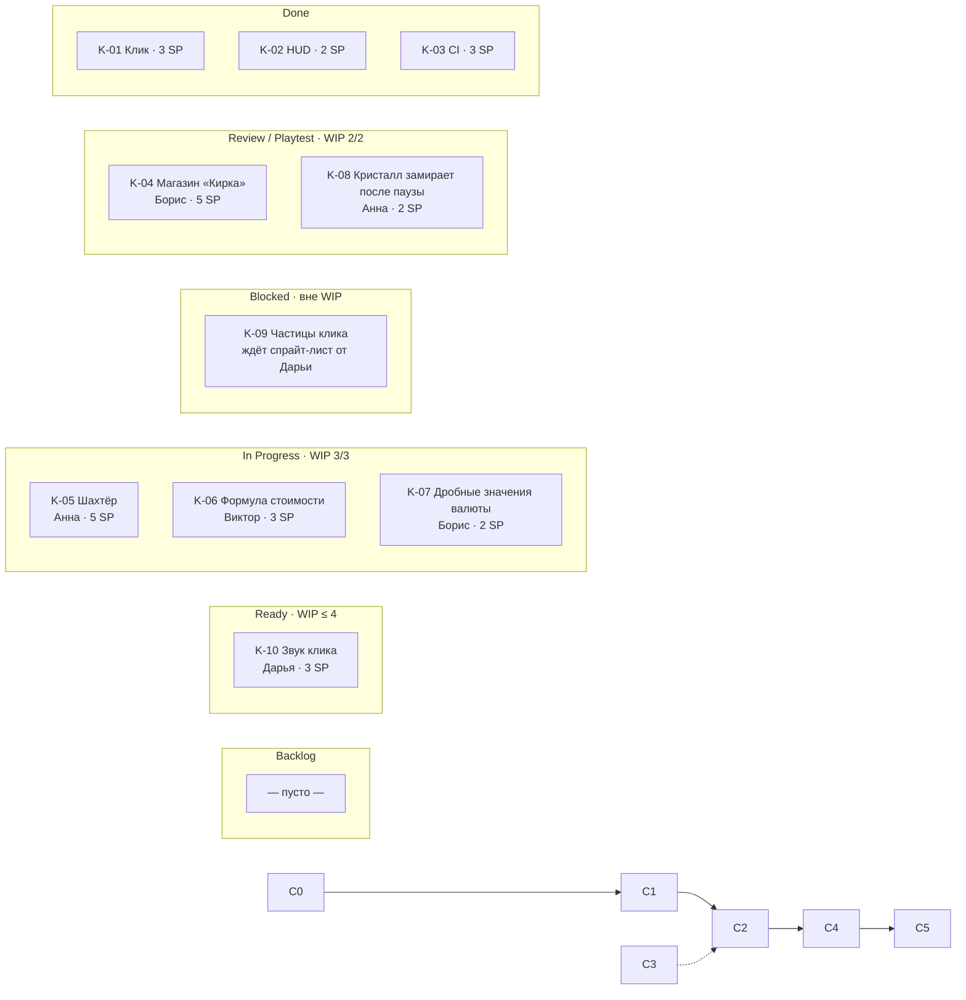
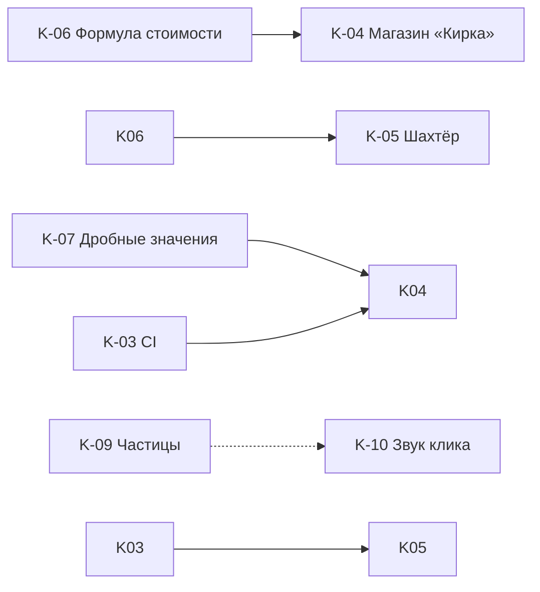

# Kanban-доска: «Crystal Miner» (Sprint 1, день 6)

## Легенда колонок и WIP-лимиты

|Колонка|WIP|Входное правило|Выходное правило|
|-|-|-|-|
|**Backlog**|—|Элемент в Product Backlog|Выполнен DoR (описание, критерии, SP)|
|**Ready**|4|DoR выполнен, выбран PO для спринта|Участник свободен и берёт карточку|
|**In Progress**|**3**|Ветка `feature/K-xx-...` создана, исполнитель назначен|PR открыт, CI зелёный|
|**Review / Playtest**|**2**|PR открыт; есть WebGL-билд|Одно ревью кода + playtest по критериям приёмки|
|**Blocked**|вне WIP|Внешняя зависимость (ассет, решение, баг)|Блокер снят → возврат в прежнюю колонку|
|**Done**|—|Выполнен DoD (см. README)|—|

**Типы карточек:** фича · баг · техзадача.

## Схема потока (колонки и WIP)

## Снимок доски (день 6 из 10)

**Зависимости между карточками:**

## Карточки (10 штук)

|ID|Тип|Название|Исполнитель|SP|Колонка|Комментарий|
|-|-|-|-|-|-|-|
|K-01|Фича|Клик по кристаллу даёт +1 руды|Анна|3|Done|Lead time 2 дня|
|K-02|Фича|HUD: счётчик руды|Борис|2|Done|Lead time 3 дня|
|K-03|Техзадача|CI: GameCI + WebGL-сборка|Егор|3|Done|Lead time 4 дня|
|K-04|Фича|Магазин «Кирка» (+1 к клику)|Борис|5|Review|Ждёт playtest, 2-й день в колонке|
|K-08|Баг|Кристалл замирает после паузы|Анна|2|Review|Воспроизводится в WebGL, ждёт проверки|
|K-05|Фича|Автогенератор «Шахтёр»|Анна|5|In Progress|Зависит от формулы K-06|
|K-06|Фича|Формула стоимости улучшений|Виктор|3|In Progress|Нужна для K-04/K-05|
|K-07|Баг|При >10 кликов/с валюта показывает дробные значения|Борис|2|In Progress|Нужно привести `float` к `long` в `OreWallet`|
|K-09|Фича|Частицы при клике|Дарья|3|**Blocked**|Нет спрайт-листа искр|
|K-10|Фича|Звук клика|Дарья|3|Ready|Не берётся до разгрузки Review|

## Правила работы с доской

1. **Pull, а не push:** исполнитель сам берёт карточку из Ready, ничего не «назначается» сверху.
2. **Stop starting, start finishing:** если в Review 2/2, новые карточки не берём — сначала помогаем с ревью.
3. **Blocked не считается в WIP**, но SM обязан вынести блокер на ближайший Daily; блокер старше 2 дней эскалируется PO-on-duty.
4. **Баги важнее фич:** баг с воспроизводимым падением WebGL-билда идёт в начало Ready.
5. **Одно ревью кода + один playtest** обязательны; автор своей карточки её не ревьюит.
6. Доска обновляется сразу при смене статуса, а не перед Daily.

## Анализ потока

**Метрики (оценочно, день 6):**

|Метрика|Значение|
|-|-|
|Throughput|3 карточки (8 SP) за 6 дней|
|Cycle time (Done)|2, 3 и 4 дня (в среднем 3 дня)|
|WIP сейчас|5 в работе (3 + 2) + 1 Blocked|
|Прогноз|8 SP из 21 готово при 60% спринта → риск недобора, нужен фокус на Review|

**Узкие места и действия:**

|Проблема|Признак|Действие|
|-|-|-|
|Узкое горло — Review/Playtest|колонка 2/2, K-07 не может перейти дальше|чек-лист playtest, чтобы любой мог проверять; дежурный ревьюер на день|
|Блокер по арту|K-09 ждёт спрайт-лист|Дарья сначала делает спрайты, звук (K-10) — после; при необходимости Борис делает временный placeholder|
|Зависимость K-05 ← K-06|Анна работает на гипотетической формуле|Виктор отдаёт черновую формулу сегодня, уточнение — после|

## Связь с Scrum

Колонка **Ready** — это отобранная часть Sprint Backlog. Карточки **K-01…K-10** соответствуют элементам PB-1…PB-7 и TECH-1; баги K-07/K-08 появились в ходе спринта и добавлены PO-on-duty в Sprint Backlog (суммарно +4 SP, компенсированы переносом PB-7 в «по возможности»).

